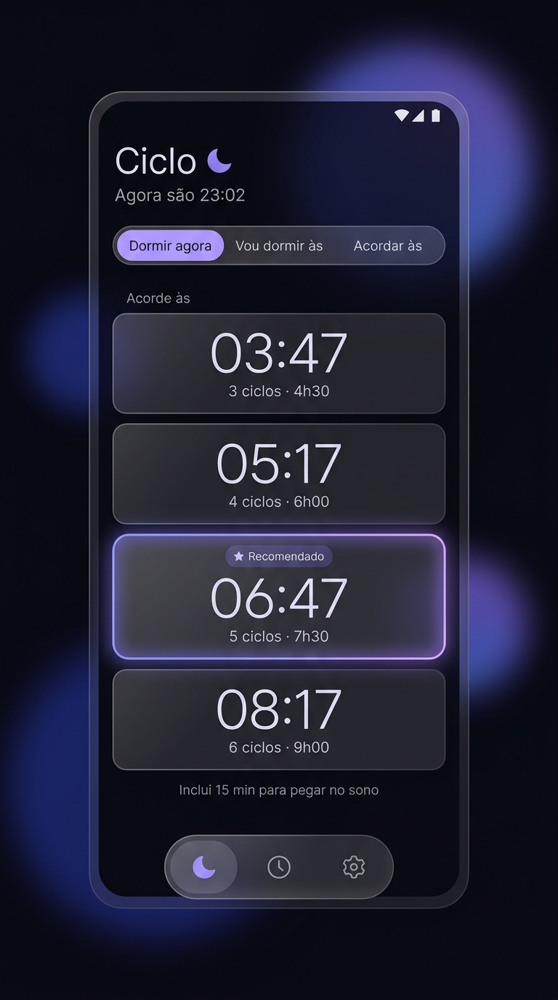
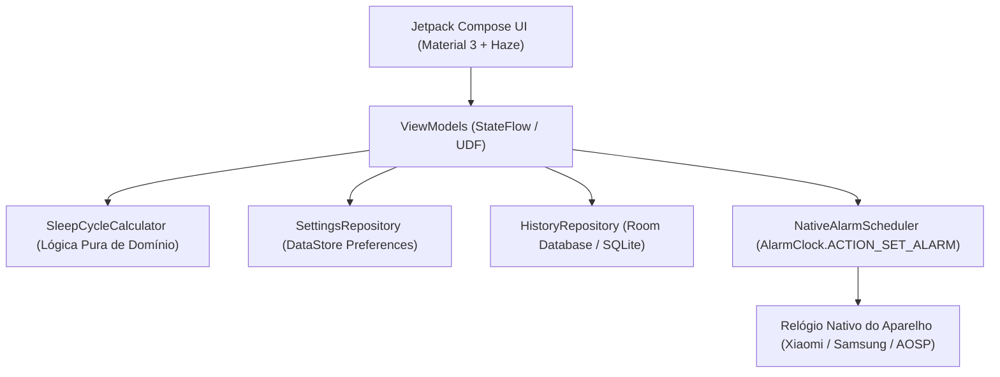

# Ciclo 🌙

[](https://github.com/muriloscolari/ciclo-alarme/actions/workflows/ci.yml)
[](https://github.com/muriloscolari/ciclo-alarme/releases/latest)
[](LICENSE)
[-green.svg)](https://developer.android.com)
[](https://kotlinlang.org)

<p align="center">
  
</p>

**Ciclo** é um aplicativo Android nativo, minimalista e focado em bem-estar. Ele calcula horários ideais de despertar e de deitar baseados nos **ciclos biológicos de sono** (compostos por fases REM e sono profundo, com durações típicas entre 90 e 120 minutos).

Ao selecionar um horário calculado, o Ciclo cria o alarme diretamente no **aplicativo de Relógio nativo do aparelho** (com foco principal em aparelhos **Xiaomi / HyperOS / MIUI**, além de **Samsung One UI** e **Pixel / Motorola / AOSP**), garantindo máxima pontualidade com zero consumo de bateria em segundo plano.

[⬇️ **Baixar o APK mais recente (Release)**](https://github.com/muriloscolari/ciclo-alarme/releases/latest)

---

## 🎯 Por que ciclos de sono?

Acordar no meio de um ciclo de sono (durante o sono profundo) é o principal causador da sensação de inércia do sono — quando você acorda indisposto, cansado e "quebrado", mesmo tendo dormido muitas horas.

O Ciclo resolve isso calculando o momento em que você estará no estágio mais leve do sono:
- **Duração do ciclo:** 90 minutos por padrão (ajustável de 90 a 120 min nas configurações).
- **Tempo para adormecer:** 15 minutos por padrão (ajustável de 0 a 60 min).
- **Opção Recomendada:** destaca **5 ciclos (~7h30 de descanso real)** como o ponto ideal de relaxamento físico e restauração cognitiva.

---

## ✨ Funcionalidades

| Modo | O que você informa | O que o Ciclo calcula | Qual alarme é criado |
|---|---|---|---|
| **Dormir agora** | Nada (usa o horário atual ao vivo) | Melhores horários para despertar | O horário que você tocar |
| **Vou dormir às X** | A hora planejada para deitar | Melhores horários para despertar | O horário que você tocar |
| **Acordar às X** | A hora em que você precisa levantar | Melhores horários para ir para a cama | Sempre o horário X |

- **Detecção de horários passados:** no modo "Acordar às", opções de deitar que já passaram ficam atenuadas. O aplicativo recomenda a maior quantidade de ciclos ainda disponível.
- **Opção de Alarme Simples:** se já for muito tarde da noite para ciclos completos, o Ciclo permite acionar um alarme simples para a hora estipulada com um toque.
- **Proteção contra alarmes duplicados:** detecta se você já enviou um alarme com o mesmo horário nas últimas 12 horas e avisa antes de reenviar.
- **Histórico Completo:** registros de alarmes salvos para sempre (Room Database) com opção de recriação rápida em 1 toque e botão direto para abrir o Relógio do aparelho.
- **Design System Dark-first com Glassmorphism:** interface elegante translúcida com desfoque de fundo (Haze), cantos suaves e auroras coloridas em tons índigo e lavanda.

---

## 📱 Compatibilidade com o Relógio Nativo

O Ciclo utiliza a Intent padrão do sistema Android `AlarmClock.ACTION_SET_ALARM`, o que garante que o alarme toque mesmo se o aplicativo Ciclo estiver fechado:

| Fabricante / Sistema | Pacote do Relógio | Compatibilidade | Comportamento do `EXTRA_SKIP_UI` |
|---|---|---|---|
| **Xiaomi / Redmi / POCO** (MIUI & HyperOS) | `com.android.deskclock` | ✅ Suportado | Em algumas versões do HyperOS abre a tela de confirmação do relógio |
| **Samsung** (One UI) | `com.sec.android.app.clockpackage` | ✅ Suportado | Salva diretamente em segundo plano |
| **Google Pixel / Motorola / AOSP** | `com.google.android.deskclock` | ✅ Suportado | Salva diretamente em segundo plano |

> **Nota:** Nas configurações do Ciclo (**Ajustes > Sobre**), você pode conferir o pacote exato do Relógio detectado no seu aparelho.

---

## 🏗️ Arquitetura & Stack Tecnológica

O projeto foi construído seguindo rigorosamente os padrões modernos recomendados pelo Google:



- **Linguagem:** Kotlin 2.0.21
- **UI Toolkit:** Jetpack Compose + Material 3 com Material You dinâmico
- **Injeção de Dependências:** Hilt (Dagger)
- **Desfoque / Glassmorphism:** [Haze](https://github.com/chrisbanes/haze)
- **Banco de Dados Local:** Room 2.6 com KSP
- **Preferências:** Jetpack DataStore Preferences
- **Datas & Horas:** `java.time` (API nativa desde o Android 8.0 / API 26)
- **CI / CD:** GitHub Actions com geração de releases automáticas assinadas

---

## 🚀 Como Compilar e Rodar

### Pré-requisitos
- JDK 21
- Android SDK com Platform API 35 e Build-Tools 34+

### Comandos
```bash
# Clonar o repositório
git clone https://github.com/muriloscolari/ciclo-alarme.git
cd ciclo-alarme

# Rodar os testes unitários
./gradlew testDebugUnitTest

# Verificar lint de código e strings (i18n)
./gradlew lintDebug

# Compilar o APK Debug
./gradlew assembleDebug

# Instalar diretamente no celular conectado via USB
./gradlew installDebug
```

---

## 📄 Licença

Distribuído sob a licença **GNU General Public License v3.0 (GPL-3.0)**. Consulte [LICENSE](LICENSE) para mais detalhes.
